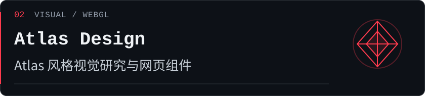
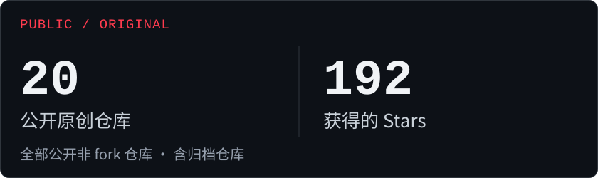
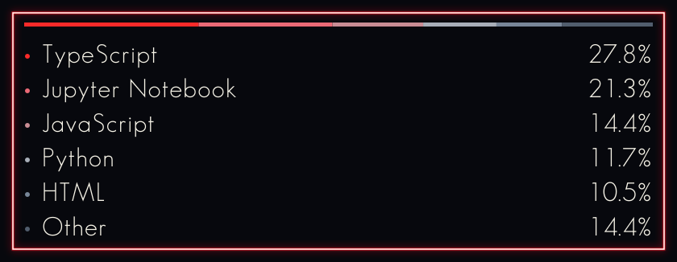

## Tech Stack

  
  
  
  
  

## Selected Projects

[Repository ↗](https://github.com/JikoSchnee/delta-harmonica-macro) · [Live Demo ↗](https://jiko-official.top/delta/)

[Repository ↗](https://github.com/JikoSchnee/Atlas-Design) · [Live Demo ↗](https://jikoschnee.github.io/Atlas-Design/)

[Repository ↗](https://github.com/JikoSchnee/design-gallery) · [Live Demo ↗](https://jikoschnee.github.io/design-gallery/)

[Repository ↗](https://github.com/JikoSchnee/Airfare-Radar) · [Live Demo ↗](https://jikoschnee.github.io/Airfare-Radar/#/dashboard)

## GitHub Overview

统计范围：JikoSchnee 拥有的全部公开非 fork 仓库（含归档仓库及本仓库）。Stars 为这些仓库的合计；语言占比按 GitHub 返回的字节数计算，不代表熟练度。每日自动更新，失败时保留上次成功结果。[更新记录](https://github.com/JikoSchnee/JikoSchnee/actions/workflows/update-profile.yml)

---

[JikoSchnee ↗](https://github.com/JikoSchnee)
